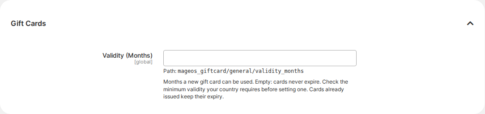
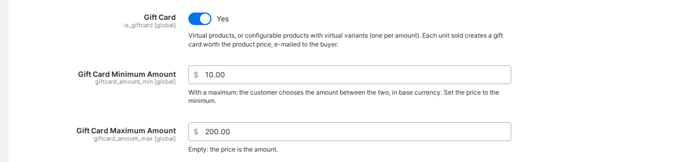
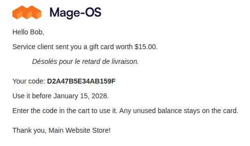
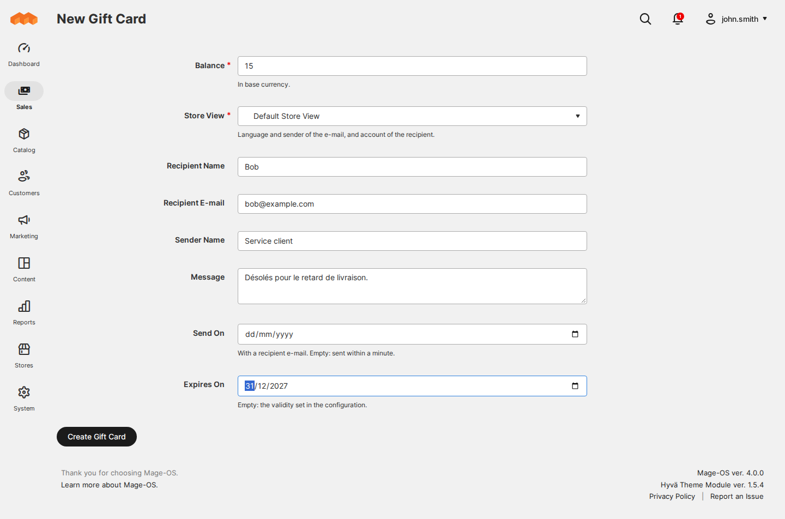
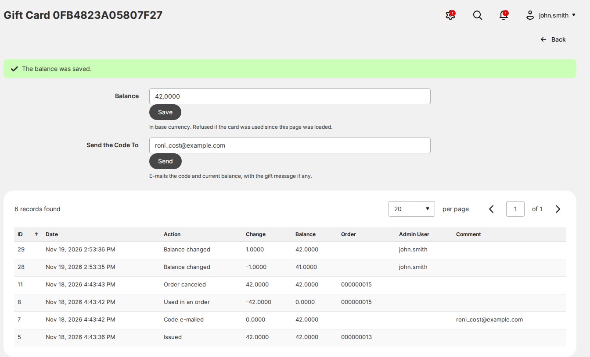
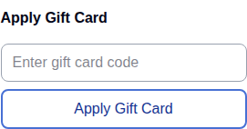
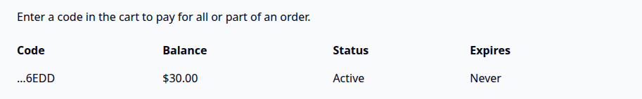

# Gift Card

`mage-os/module-gift-card` (`MageOS_GiftCard`) — a module for Mage-OS / Magento Open Source.

Gift cards that are sold as regular products and redeemed in the cart.

- Flag a virtual product, or a configurable product whose variants are all virtual (one variant per amount), with the *Gift Card* attribute. Gift cards never need shipping: the attribute is not offered on other product types, and saving a gift card that would need shipping (a variant with a weight, for example) is refused. When its invoice is paid, one code per unit is created with a balance equal to what the unit was paid (price including tax, less its share of any cart discount), e-mailed to the buyer and recorded as an order comment with only its last characters.
- Customer-chosen amount: give a virtual gift card a minimum (above 0) and a maximum amount, and the customer types the amount on the product page.
- Send as a gift: on the product page, the buyer can enter a recipient name and e-mail, their own name, a message and a send date. The recipient receives the code by e-mail on that date (right after the invoice without a date); the buyer's e-mail shows only the end of that code.
- Customers enter codes in the cart, or in the order summary of Hyvä Checkout and Loki Checkout, up to five per order. The amount is deducted after tax, like a means of payment; the remaining balance stays on each card. Gift cards cannot pay for gift cards bought in the same cart. After 10 wrong codes in one cart, codes are refused in that cart for 15 minutes.
- The balance is debited atomically when the order is placed, and credited back on order cancellation or credit memo; money given back to an expired card can be spent for 30 more days. Refunding a purchased gift card disables the cards of the refunded line, unspent ones first; a card already partly spent is noted on the order. A credit memo that would leave the customer with active cards and refunded money for more than was paid is refused.
- Two cron jobs repair what a request that died half-way leaves behind: a card debited for an order that was never saved gets its money back an hour later, and a paid invoice that issued no card gets its cards within 15 minutes.
- REST and GraphQL: apply, remove and list the gift cards of a cart, and list the cards of a customer account. See [API](#api).
- *My Gift Cards* in the customer account lists the cards of the account, with balance, status and expiry. A card belongs to the logged-in buyer, or for a gift to the account with the recipient's e-mail; a gift shows up there only once e-mailed, with the end of its code (the full code is in the e-mail). There is no public page to look up a code's balance.
- Optional expiry, after a validity in months set in the configuration, with an optional reminder e-mailed to the holder some days before a card with a balance left expires.
- The gift card lines (amount, recipient, message, send date) are shown with the cart item, in the order, invoices and e-mails; the gift card total is shown in cart totals, the checkout summary, order views, the order e-mail and admin invoices / credit memos.
- PayPal: the amount paid by gift card is sent to PayPal as a *Gift Card* line, so that the lines PayPal shows add up to what the customer pays.
- *Sales > Operations > Gift Cards* lists every card. Change a card's status or expiry in the grid, create a card (goodwill gesture, contest prize) or many at once (a number of identical cards, or a CSV file, for campaigns and B2B orders), and see every change of a card's balance in its *History*, where the balance can be changed and the code e-mailed again. Separate ACL resources for viewing, creating, changing and e-mailing cards.

Limitations: no multi-address checkout (a code applied in the cart is not deducted there, and the card is not debited), and amounts chosen in base currency. A card can be spent on every website of the installation, its balance read in the base currency of the website where it is spent: with several websites in different base currencies, or brands that should not share cards, do not sell gift cards on more than one of them.

## Compatibility

Mage-OS 3.6 and 4.x, and Magento Open Source 2.4.9: all share the Magento 2.4.9 base (`magento/framework` ^103.0.9). PHP 8.3 to 8.5. CI runs the check-extension workflow on the currently supported Mage-OS versions (today Mage-OS 3.6.0 with PHP 8.4; Mage-OS 4.0 joins once the check-extension actions know it); developed on Mage-OS 4.0.0 with PHP 8.5.

- **Luma** (theme and checkout): supported, run in a browser on Mage-OS 4.0.0 (product page with gift fields, cart form and totals, checkout summary and order, *My Gift Cards*). Its *Check Out with Multiple Addresses* does not use gift cards: a code applied in the cart is ignored there, and the orders are placed at their full total.
- **Hyvä Theme**: supported, run on the Hyvä default theme 1.5. The cart total line follows the default theme's own templates (inline Alpine expressions): it was not run on the Hyvä CSP theme.
- **Hyvä Checkout**: written from its layouts, not run (no licensed install): check it on yours. See [Checkouts](#checkouts).
- **Loki Checkout**: supported, run on Loki Checkout 2.8 with the Hyvä default theme. See [Checkouts](#checkouts).
- **Elasticsuite**: nothing to integrate. The three product attributes are not searchable, filterable or sortable, and the module touches neither search nor product lists; no reindex is needed. Run with Elasticsuite 2.12 as the search engine: gift card products are found by the catalog search.

Bulk creation, the expiry reminder, the product image in the gift e-mail, the PayPal line and the erasure on account deletion (not released yet) touch the admin, e-mails, cron and server-side events only, no storefront template: nothing changes for Luma, Hyvä, Hyvä Checkout, Loki Checkout or Elasticsuite. It is covered by unit tests and integration tests run by CI; it was not run on a shop. The PayPal line was not run against PayPal: see [Checkouts](#checkouts).

The REST routes and the GraphQL schema were written from core's own (coupons, cart) and are covered by unit tests of their rules; they were not called on a running shop. The module requires neither `Magento_Webapi` nor the GraphQL modules: without them, the routes and the schema are simply not read.

## Installation

```bash
composer config repositories.mageos-gift-card vcs https://github.com/mage-os-lab/module-gift-card
composer require mage-os/module-gift-card
bin/magento module:enable MageOS_GiftCard
bin/magento setup:upgrade
```

## Configuration

*Stores > Configuration > Sales > Gift Cards > Gift Cards* (ACL resource *Stores > Settings > Configuration > Gift Cards*):

- **Validity (Months)**: how long a new card can be used. Empty (the default): cards never expire. Rules on gift card validity differ by country (some require a minimum duration and a clearly shown expiry date): check yours before setting one. Changing it does not change cards already issued; change those in the grid.
- **Expiry Reminder (Days Before)**: that many days before a card expires, e-mail its holder a reminder with the end of its code, its balance and its expiry date. Empty (the default): no reminder. Only active cards with a balance left and an expiry date get one, once per card; a card whose expiry date is changed (in the grid, or when an order gives money back to an expired card) gets one again for its new date. The holder is the recipient of a gift once it was e-mailed to them, else the customer account that owns the card, else the buyer of a guest order, for a card never given away; the address of an order placed by a customer account is never used, so a card whose account was deleted has nobody to remind. A card created in the admin without a recipient or an account has nobody to remind either. A reminder that fails to send is logged, with its exception, in `var/log/exception.log` ("Gift card expiry reminder failed for card <ID>"; also in `var/log/debug.log` when debug logging is on, as it is by default outside production mode) and tried again by the next run, every hour, until it is sent or the card expires.



Product attributes, all global:

- **Gift Card** (virtual and configurable products): the product sells gift cards.
- **Gift Card Minimum Amount** and **Gift Card Maximum Amount** (virtual products): with both set, the customer chooses the amount between the two, in base currency. The minimum must be above 0, so that no card is free. Set the product price to the minimum, which is the price shown in the catalog.

Cart price rules apply to gift cards like to any product: a card bought with a discount is worth what was paid for it. To sell them at full value only, add to the rule's *Actions* the condition *Gift Card is No*.



E-mails, sent from the *Sales Representative* identity of the store:

- *Gift Card Codes* (`mageos_giftcard_issued`): to the buyer, with the codes of the invoice; for gifts, only the end of the code, to whom and when it is sent.
- *Gift Card for a Recipient* (`mageos_giftcard_gift`): to the recipient, with the code, balance, sender, message and expiry (in the language and time zone of the card's store view), and the image of the gift card product it was bought as (its *Small Image*, else its *Base Image*, at its original size, shown 300 pixels wide). Cards created in the admin have no product, hence no image. Sent by the `mageos_giftcard_send_gifts` cron job, every minute: Magento's cron must run. A failed e-mail is tried again each minute, five times at most.
- *Gift Card Expiry Reminder* (`mageos_giftcard_expiry`): to the holder of a card about to expire, with the end of its code, its balance and its expiry date. Sent by the `mageos_giftcard_remind_expiry` cron job, only when *Expiry Reminder (Days Before)* is set.



Cron jobs (group `default`), all needing Magento's cron:

- `mageos_giftcard_send_gifts`, every minute: the gift e-mails whose date has come, 100 per run.
- `mageos_giftcard_issue_missing`, every 15 minutes: issues the cards that an invoice paid in the last 7 days should have issued and did not (an error while they were created, a request that died), 5 minutes after the payment at the earliest. Each one is logged in `var/log/system.log` ("gift card(s) issued late"). Only for orders placed after the upgrade from 2.0.0.
- `mageos_giftcard_give_back_orphans`, every hour: gives back what a card paid for an order that was never saved. The card is debited just before the order is saved; when the request dies in between (PHP killed, server restart), no order exists and the money would be lost. A debit of the last 7 days, older than an hour, whose order number is in no order, is credited back, with *The order was never saved* in the card's history and a line in `var/log/system.log` ("was debited but never saved"). An order that exists is never touched. If you delete orders from the database, the gift cards that paid for an order deleted within 7 days get their money back too.
- `mageos_giftcard_remind_expiry`, every hour: the expiry reminders that are due, 100 per run. Does nothing while *Expiry Reminder (Days Before)* is empty.

## Managing gift cards

*Sales > Operations > Gift Cards* shows all cards. Filter by code, balance, status, expiry, recipient, *Customer* (the e-mail of the account that owns the card), *Bought In* (the order the card was bought in) or date. *Columns* adds the recipient and sender names, the send date and when the gift was e-mailed; views can be saved as bookmarks, and *Export* downloads the filtered cards as CSV or Excel XML, full codes included. Amounts are in base currency. The orders a card paid for are in its *History*. Click a row to edit its *Status* or *Expires* date in place, then *Save*; select several rows to change them together. A disabled or expired card keeps its balance but cannot be applied in the cart or spent at checkout. Cards issued before version 1.1.0 have no initial balance or order.

ACL resources, under *Sales > Operations > Gift Cards* (which alone gives the grid and the history, read only):

- *Create Gift Cards*: *Add Gift Card* and *Create in Bulk*.
- *Change Balance, Status and Expiry*: editing in the grid, and the balance on the history page.
- *See Full Codes and E-mail Them*: full codes in the grid, its export and the history page, and *Send the Code To* on the history page. Without it, an admin sees only the last four characters of each code, and finds a card by typing its whole code in the *Code* filter: a code is all it takes to spend a card, so give this resource only to the roles that need it.

*Add Gift Card* creates a card without an order: balance, store view (language and sender of the e-mail), and optionally a recipient, sender name, message, send date and expiry date. With a recipient e-mail, the card is e-mailed like a gift and belongs to the customer account with that e-mail, if any.



*Create in Bulk* creates many cards without an order, for a campaign or a B2B order: either a *Number of Cards*, identical and without recipient, with the *Balance* and *Expires On* of the form, or one card per line of a CSV file. All the cards are created, or none: a wrong line refuses the whole file, and the message names the line. Up to 1,000 cards per form or file; the store view of the form applies to all of them.

The file is comma or semicolon separated, UTF-8, and its first line names its columns, in any order, among `balance`, `recipient_email`, `recipient_name`, `sender_name`, `message`, `send_date` and `expires_date` (dates as `YYYY-MM-DD`, in the store's time zone). A line without a balance takes the form's *Balance*, a line without an expiry date the form's *Expires On*, else the configured validity. A line with a recipient e-mail is e-mailed like a gift, on its send date, by the cron (100 a minute), and belongs to the customer account with that e-mail, if any. The same checks as *Add Gift Card* apply (valid e-mail, no links, lengths, send date within a year). For example:

```csv
balance,recipient_email,recipient_name,message,send_date
50,anna@example.com,Anna,Happy holidays,2026-12-24
50,ben@example.com,Ben,Happy holidays,2026-12-24
25,,,,
```

Admins with *See Full Codes and E-mail Them* then download a CSV of the cards created (`code`, `balance`, `expires_at` in UTC, `recipient_email`), generated on the fly and not kept on the server; it holds spendable codes, so store it as safely as money. Other admins go back to the grid, where the new cards can be found by their creation date.


*History*, at the end of each row, lists the card's changes, newest first: the change, the balance it left, the order number, the admin user for changes made in the admin, and a comment (the address the code was e-mailed to, the new expiry date, the credit memo that disabled it). History starts with version 1.1.0: older changes are not listed.

*Balance*, above the history, sets a new balance (a goodwill gesture, a correction). It is refused if the card was used since the page was loaded, so that a payment made meanwhile is not overwritten.

*Send the Code To* e-mails the code and current balance again, to the recipient or buyer by default or to any address typed there (the customer lost the e-mail, or gave a wrong address). A gift not sent yet still goes to its recipient on its date when the code is sent to another address.



## API

All amounts are in base currency, dates in UTC. The rules are those of the cart form: up to five cards per cart, and after 10 wrong codes in one cart, codes are refused in that cart for 15 minutes. A code is refused with the message the cart form shows (HTTP 400 in REST). There is no route to look up the balance of a code that is not applied to a cart, and no admin route.

REST, as the logged-in customer (customer token):

| Route | Does |
|---|---|
| `GET /V1/carts/mine/gift-cards` | lists the cards applied to the cart |
| `POST /V1/carts/mine/gift-cards`, body `{"code": "…"}` | applies a code, returns the list |
| `POST /V1/carts/mine/gift-cards/remove`, body `{"code": "…"}` | removes a code, returns the list |
| `GET /V1/customers/me/gift-cards` | lists the cards of the account, as *My Gift Cards* does |

The same three cart routes exist for guests under `/V1/guest-carts/:cartId/gift-cards`, with the masked cart ID. They answer only for guest carts: the cart of a customer account is not reachable with its masked ID alone. Codes are sent in the request body, never in the URL, so that they do not end up in access logs.

Each card is returned as `code`, `balance`, `status` (`active`, `disabled`, `expired`, `used_up`), `expires_at` and, in a cart, `applied_amount` (what the card pays of that cart). In the account list, a gift shows only the end of its code, as in *My Gift Cards*.

GraphQL:

```graphql
mutation {
  applyGiftCardToCart(input: {cart_id: "…", gift_card_code: "…"}) {
    cart {
      applied_gift_cards { code applied_balance { value currency } current_balance { value currency } expiration_date }
      prices { grand_total { value currency } }
    }
  }
}
```

`removeGiftCardFromCart` takes the same input. `applied_gift_cards` is a field of any `Cart`; `customer { gift_cards { code balance { value currency } status expiration_date } }` lists the cards of the logged-in customer. The names follow those of Adobe Commerce's gift card schema where it has a counterpart; `Customer.gift_cards` is this module's own.

## Getting started

1. Create a virtual product, for example "Gift card 25", priced 25, with no tax class, and set *Gift Card* to Yes.
   To sell several amounts in one product, create a configurable product instead, with *Weight* set to *This item has no weight* so that the generated variants are virtual, one variant per amount (25, 50, 100...). Set *Gift Card* to Yes on the configurable product itself, not on its variants.
2. Order it and invoice the order. The codes are sent when the invoice is paid, not when the order is placed: with an offline payment (check / money order, bank transfer), only once an admin creates the invoice. Once the invoice is saved, the buyer receives the code by e-mail and the code is added as an order comment.
   To offer it, fill in *Send It as a Gift* on the product page: the recipient gets the code by e-mail on the chosen date.


3. In another cart, open *Apply Gift Card*, enter the code and apply it: the amount is deducted from the grand total. *Add Another Gift Card* combines several cards; they are used in the order applied.



The same cart on Luma, with the gift lines of the item:


4. Logged-in customers find their cards, and what is left on them, in *My Account > My Gift Cards*.



## Checkouts

A code applied in the cart is kept through any checkout, and the cards are debited when the order is placed, whatever the checkout.

- **Luma checkout**: the gift card line is in the order summary; codes are entered in the cart.
- **Hyvä Checkout**: the gift card line is in the price summary, with the *Apply Gift Card* form under it.
- **Loki Checkout**: the gift card line is in the sidebar totals, with the *Apply Gift Card* form after the coupon code.

**PayPal**: when PayPal receives the cart's lines (PayPal Express Checkout, Payflow), the gift card amount is sent as a negative line *Gift Card*, in base currency, so that the lines add up to the amount to pay. When the lines cannot be sent as they are (a gift card that also pays the shipping or tax, leaving the items at 0 or less), core sends the totals only, which still add up. This was written from core's PayPal source and covered by a unit test on core's payment cart: it was not run against PayPal (no sandbox account here). Check an order paid partly by gift card with PayPal in your sandbox before going live. Payment methods that do not use core's payment cart (Braintree, Adyen, Stripe...) receive the amount to pay without the line.

In Hyvä Checkout and Loki Checkout the form is the cart's, posted as a plain form: applying or removing a code reloads the checkout, on the same step, with what the customer already filled in. Neither checkout is required by the module. Tested with Loki Checkout 2.8 on the Hyvä default theme (apply, remove, wrong code, orders paid in part and in full by a card). The Hyvä Checkout integration was written from its layouts without a licensed install to run it on: check it on yours.

On Hyvä, the module's templates use Tailwind classes: rebuild the theme's styles after installing it (the module registers itself for Hyvä's Tailwind compilation).

## Troubleshooting

- **No code after invoicing**: the product's *Gift Card* attribute is No at the global scope, or the invoice was not paid (offline "Not capture").
- **Code e-mail missing**: the codes are in *Sales > Operations > Gift Cards* (filter *Bought In* by the order number), and their last characters in the order comments; check mail sending and `var/log/exception.log` (or `var/log/debug.log` when debug logging is on) for "Gift card e-mail failed".
- **Recipient never got the gift e-mail**: check the card's *History* for "Code e-mailed". Without it, the send date has not come, the card is disabled, or Magento's cron does not run (`bin/magento cron:run`). Failed sends are logged in `var/log/exception.log` ("Gift card e-mail failed") and tried again every minute, five times at most. Use *Send the Code To* to send it by hand.
- **"The gift card balance has changed" at checkout**: the balance was used in another order meanwhile, or the card was disabled or expired; the customer must review the cards in the cart.
- **"This gift card code is not valid or has no balance left"** for a known code: the card is disabled, expired or its balance is 0 in *Sales > Operations > Gift Cards*.
- **"Choose a gift card amount between …"**: the product has a minimum and maximum amount, and the amount was missing or outside them (for example *Add to Cart* from a category page: open the product page).
- **A card is missing from *My Gift Cards***: cards issued before 1.1.0, or bought as a guest, belong to no account; a gift goes to the account whose e-mail is the recipient's, in the website of the order, and shows up once e-mailed.
- **"Too many wrong gift card codes"**: 10 wrong codes were entered in the cart in the last 15 minutes. It lifts by itself; flushing the cache lifts it at once.
- **"Gift cards in your cart cannot be paid with a gift card"**: the cart contains a gift card product; the applied cards pay only for the rest of the cart.
- **"The balance of gift card … changed meanwhile"** on the history page: the card was used since the page was loaded. Reload the page and set the balance again.
- **"Gift card … was refunded and disabled, but only … was left on it"** in an order comment: the refunded card had been spent in part. The customer got back more than was left on the card; decide whether to recover the difference.
- **"Gift card … is disabled: the … given back stays on it"** in an order comment: a canceled or refunded order gave money back to a disabled card. Enable the card in the grid if the customer should keep it.
- **"This refund would leave the customer with more than was paid"** when creating a credit memo: the order issued gift cards that are still active, and with this refund the customer would hold those cards and refunded money for more than the order was paid. Typically an *Adjustment Refund* entered to refund a gift card, with its quantity left at 0: enter the quantity instead, which disables the card. For a goodwill refund on top, disable the cards first in *Sales > Operations > Gift Cards*.
- **"The order was never saved"** in a card's history: the card was debited for an order whose request died before the order was saved; the hourly cron gave the money back. Nothing to do.
- **"The first line of the file must name its columns"** or **"Line … : …"** on *Create in Bulk*: the CSV header has a column the module does not know (check the spelling, see *Managing gift cards*), or that line is wrong; no card was created. Fix the file and send it again.
- **No expiry reminder**: *Expiry Reminder (Days Before)* is empty, the card has no expiry, no balance left, is disabled, was already reminded for this date, or has nobody to remind (an admin card without recipient or account, a gift not e-mailed yet, a card whose customer account was deleted). Check the card's *History* for "Expiry reminder e-mailed", and `var/log/exception.log` (or `var/log/debug.log` when debug logging is on) for "Gift card expiry reminder failed".
- **"gift card(s) issued late"** in `var/log/system.log`: a paid invoice had not issued its cards; the cron issued and e-mailed them. Look for the error logged when the invoice was paid.
- **"The refunded gift cards were already spent for …"** when creating a credit memo: the gift cards being refunded were used to pay for other orders. Enter that amount as *Adjustment Fee* to refund only what is left on them, or refund fewer units.
- **"Links are not allowed in the gift card names and message"**: the shop e-mails this text to an address the buyer chose, so web addresses are refused.
- **"Set a gift card minimum amount above 0"** when saving a product: a maximum amount needs a minimum above 0 and not above the maximum.
- **"All variants of a gift card must be virtual products"** or **"must stay a virtual product"**: a variant has a weight, which makes it a simple product that needs shipping. Remove the weight (*This item has no weight*).
- **"Only a virtual product, or a configurable product with virtual variants, can be a gift card"**: a weight was given to a virtual gift card. Set *Gift Card* to No first if the product should become a shipped product.

## Personal data

The module stores the recipient's e-mail address and name, the sender's name and the gift message in `mageos_giftcard`, the addresses codes were e-mailed to in `mageos_giftcard_history.comment` (an expiry reminder line records no address), and the same gift fields in the cart and order item options.

When a customer account is deleted (admin, customer grid mass action, REST, or any code that deletes it through Magento's customer model), in the same transaction as the deletion:

- the cards the account owned lose their owner (`customer_id`) and, once delivered, their recipient e-mail and name, sender name and message;
- the gifts the customer bought lose the sender name once e-mailed to their recipient;
- the customer's e-mail address is removed from the history comments (codes e-mailed to it), and the comments of the reminder lines of its cards and of the gifts it bought are emptied, whatever address they hold;
- its cards are no longer reminded through the e-mail address Magento keeps on its orders: only a guest order's address is used for reminders.

Balances, statuses, expiry dates, the order a card was bought in, and the history of balance changes (amounts, balances, order numbers, admin users) are kept: they are accounting records, and the money on a card stays spendable by whoever holds its code. A gift not e-mailed yet keeps its recipient, sender name and message until it is sent, so that the gift the customer paid for still reaches its recipient: it is not erased afterwards. Nothing is erased when a customer row is deleted directly in the database, nor in the cart and order item options and the order comments, which Magento keeps with the orders: include these in your own erasure and retention procedures. Gift card codes are stored as they are in `mageos_giftcard.code`, `quote.giftcard_code` and `sales_order.giftcard_code`: anonymise the three columns in any copy of the database (staging, developer dumps), or the copy holds spendable codes.

## More

- [CHANGELOG](CHANGELOG.md)
- [Security policy](SECURITY.md)
- [License](LICENSE.txt): Open Software License 3.0. This module contains no code from Adobe Commerce.
