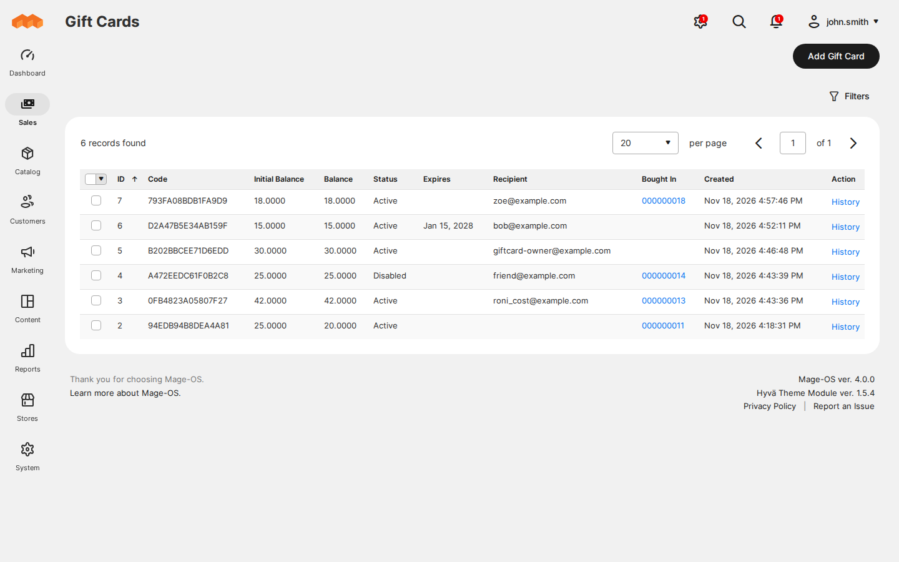
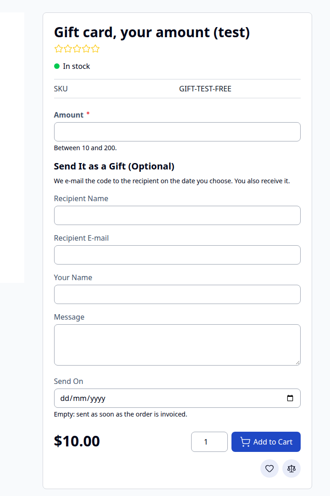
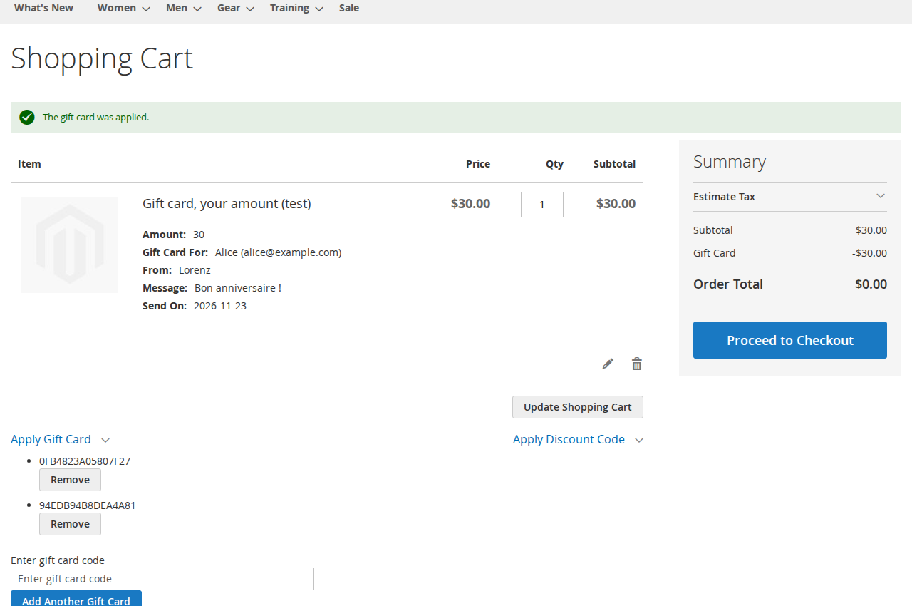

# Gift Card

`mage-os/module-gift-card` (`MageOS_GiftCard`) — a module for Mage-OS / Magento Open Source.

Gift cards that are sold as regular products and redeemed in the cart.

- Flag a virtual product, or a configurable product whose variants are all virtual (one variant per amount), with the *Gift Card* attribute. Gift cards never need shipping: the attribute is not offered on other product types, and saving a gift card that would need shipping (a variant with a weight, for example) is refused. When its invoice is paid, one code per unit is created with a balance equal to what the unit was paid (price including tax, less its share of any cart discount), e-mailed to the buyer and recorded as an order comment with only its last characters.
- Customer-chosen amount: give a virtual gift card a minimum (above 0) and a maximum amount, and the customer types the amount on the product page.
- Send as a gift: on the product page, the buyer can enter a recipient name and e-mail, their own name, a message and a send date. The recipient receives the code by e-mail on that date (right after the invoice without a date); the buyer's e-mail shows only the end of that code.
- Customers enter codes in the cart, up to five per order. The amount is deducted after tax, like a means of payment; the remaining balance stays on each card. Gift cards cannot pay for gift cards bought in the same cart. After 10 wrong codes from one IP address, codes are refused for 15 minutes.
- The balance is debited atomically when the order is placed, and credited back on order cancellation or credit memo; money given back to an expired card comes with a new validity. Refunding a purchased gift card disables the cards of the refunded line, unspent ones first; a card already partly spent is noted on the order.
- *My Gift Cards* in the customer account lists the cards of the account, with balance, status and expiry. A card belongs to the logged-in buyer, or for a gift to the account with the recipient's e-mail; a gift shows up there only once e-mailed, with the end of its code (the full code is in the e-mail). There is no public page to look up a code's balance.
- Optional expiry, after a validity in months set in the configuration.
- The gift card lines (amount, recipient, message, send date) are shown with the cart item, in the order, invoices and e-mails; the gift card total is shown in cart totals, the checkout summary, order views, the order e-mail and admin invoices / credit memos.
- *Sales > Operations > Gift Cards* lists every card. Change a card's status or expiry in the grid, create a card (goodwill gesture, contest prize), and see every change of a card's balance in its *History*, where the balance can be changed and the code e-mailed again. Separate ACL resources for viewing, creating, changing and e-mailing cards.

Limitations: no multi-address checkout, amounts chosen in base currency, and no integration with Hyvä Checkout. A card can be spent on every website of the installation, its balance read in the base currency of the website where it is spent: with several websites in different base currencies, or brands that should not share cards, do not sell gift cards on more than one of them.

## Compatibility

Mage-OS 3.6 and 4.x, and Magento Open Source 2.4.9: all share the Magento 2.4.9 base (`magento/framework` ^103.0.9). PHP 8.3 to 8.5. CI runs the check-extension workflow on the currently supported Mage-OS versions (today Mage-OS 3.6.0 with PHP 8.4; Mage-OS 4.0 joins once the check-extension actions know it); developed on Mage-OS 4.0.0 with PHP 8.5. Storefront: Hyvä default theme (1.5) and Luma; Hyvä Checkout and GraphQL are not supported.

## Installation

```bash
composer config repositories.mageos-gift-card vcs https://github.com/mage-os-lab/module-gift-card
composer require mage-os/module-gift-card
bin/magento module:enable MageOS_GiftCard
bin/magento setup:upgrade
```

## Configuration

*Stores > Configuration > Sales > Gift Cards > Gift Cards* (ACL resource *Stores > Settings > Configuration > Gift Cards*):

- **Validity (Months)**: how long a new card can be used. Empty (the default): cards never expire. Rules on gift card validity differ by country (some require a minimum duration and a clearly shown expiry date): check yours before setting one. Changing it does not change cards already issued; change those in the grid.


Product attributes, all global:

- **Gift Card** (virtual and configurable products): the product sells gift cards.
- **Gift Card Minimum Amount** and **Gift Card Maximum Amount** (virtual products): with both set, the customer chooses the amount between the two, in base currency. The minimum must be above 0, so that no card is free. Set the product price to the minimum, which is the price shown in the catalog.

Cart price rules apply to gift cards like to any product: a card bought with a discount is worth what was paid for it. To sell them at full value only, add to the rule's *Actions* the condition *Gift Card is No*.


E-mails, sent from the *Sales Representative* identity of the store:

- *Gift Card Codes* (`mageos_giftcard_issued`): to the buyer, with the codes of the invoice; for gifts, only the end of the code, to whom and when it is sent.
- *Gift Card for a Recipient* (`mageos_giftcard_gift`): to the recipient, with the code, balance, sender, message and expiry (in the language and time zone of the card's store view). Sent by the `mageos_giftcard_send_gifts` cron job, every minute: Magento's cron must run. A failed e-mail is tried again each minute, five times at most.


## Managing gift cards

*Sales > Operations > Gift Cards* shows all cards. Filter by code, balance, status, expiry, recipient, *Bought In* (the order the card was bought in) or date. The orders a card paid for are in its *History*. Click a row to edit its *Status* or *Expires* date in place, then *Save*; select several rows to change them together. A disabled or expired card keeps its balance but cannot be applied in the cart or spent at checkout. Cards issued before version 1.1.0 have no initial balance or order.

ACL resources, under *Sales > Operations > Gift Cards* (which alone gives the grid and the history, read only):

- *Create Gift Cards*: *Add Gift Card*.
- *Change Balance, Status and Expiry*: editing in the grid, and the balance on the history page.
- *E-mail Codes*: *Send the Code To* on the history page.

*Add Gift Card* creates a card without an order: balance, store view (language and sender of the e-mail), and optionally a recipient, sender name, message, send date and expiry date. With a recipient e-mail, the card is e-mailed like a gift and belongs to the customer account with that e-mail, if any.




*History*, at the end of each row, lists the card's changes, newest first: the change, the balance it left, the order number, the admin user for changes made in the admin, and a comment (the address the code was e-mailed to, the new expiry date, the credit memo that disabled it). History starts with version 1.1.0: older changes are not listed.

*Balance*, above the history, sets a new balance (a goodwill gesture, a correction). It is refused if the card was used since the page was loaded, so that a payment made meanwhile is not overwritten.

*Send the Code To* e-mails the code and current balance again, to the recipient or buyer by default or to any address typed there (the customer lost the e-mail, or gave a wrong address).


## Getting started

1. Create a virtual product, for example "Gift card 25", priced 25, with no tax class, and set *Gift Card* to Yes.
   To sell several amounts in one product, create a configurable product instead, with *Weight* set to *This item has no weight* so that the generated variants are virtual, one variant per amount (25, 50, 100...). Set *Gift Card* to Yes on the configurable product itself, not on its variants.
2. Order it and invoice the order. The codes are sent when the invoice is paid, not when the order is placed: with an offline payment (check / money order, bank transfer), only once an admin creates the invoice. Once the invoice is saved, the buyer receives the code by e-mail and the code is added as an order comment.
   To offer it, fill in *Send It as a Gift* on the product page: the recipient gets the code by e-mail on the chosen date.



3. In another cart, open *Apply Gift Card*, enter the code and apply it: the amount is deducted from the grand total. *Add Another Gift Card* combines several cards; they are used in the order applied.


The same cart on Luma, with the gift lines of the item:



4. Logged-in customers find their cards, and what is left on them, in *My Account > My Gift Cards*.


On Hyvä, the module's templates use Tailwind classes: rebuild the theme's styles after installing it (the module registers itself for Hyvä's Tailwind compilation).

## Troubleshooting

- **No code after invoicing**: the product's *Gift Card* attribute is No at the global scope, or the invoice was not paid (offline "Not capture").
- **Code e-mail missing**: the codes are in *Sales > Operations > Gift Cards* (filter *Bought In* by the order number), and their last characters in the order comments; check mail sending and `var/log/system.log` for "Gift card e-mail failed".
- **Recipient never got the gift e-mail**: check the card's *History* for "Code e-mailed". Without it, the send date has not come, the card is disabled, or Magento's cron does not run (`bin/magento cron:run`). Failed sends are logged in `var/log/system.log` ("Gift card e-mail failed") and tried again every minute, five times at most. Use *Send the Code To* to send it by hand.
- **"The gift card balance has changed" at checkout**: the balance was used in another order meanwhile, or the card was disabled or expired; the customer must review the cards in the cart.
- **"This gift card code is not valid or has no balance left"** for a known code: the card is disabled, expired or its balance is 0 in *Sales > Operations > Gift Cards*.
- **"Choose a gift card amount between …"**: the product has a minimum and maximum amount, and the amount was missing or outside them (for example *Add to Cart* from a category page: open the product page).
- **A card is missing from *My Gift Cards***: cards issued before 1.1.0, or bought as a guest, belong to no account; a gift goes to the account whose e-mail is the recipient's, in the website of the order, and shows up once e-mailed.
- **"Too many wrong gift card codes"**: 10 wrong codes were entered from the customer's IP address in the last 15 minutes. It lifts by itself; flushing the cache lifts it at once.
- **"Gift cards in your cart cannot be paid with a gift card"**: the cart contains a gift card product; the applied cards pay only for the rest of the cart.
- **"The balance of gift card … changed meanwhile"** on the history page: the card was used since the page was loaded. Reload the page and set the balance again.
- **"Gift card … was refunded and disabled, but only … was left on it"** in an order comment: the refunded card had been spent in part. The customer got back more than was left on the card; decide whether to recover the difference.
- **"Gift card … is disabled: the … given back stays on it"** in an order comment: a canceled or refunded order gave money back to a disabled card. Enable the card in the grid if the customer should keep it.
- **"Set a gift card minimum amount above 0"** when saving a product: a maximum amount needs a minimum above 0 and not above the maximum.
- **"All variants of a gift card must be virtual products"** or **"must stay a virtual product"**: a variant has a weight, which makes it a simple product that needs shipping. Remove the weight (*This item has no weight*).
- **"Only a virtual product, or a configurable product with virtual variants, can be a gift card"**: a weight was given to a virtual gift card. Set *Gift Card* to No first if the product should become a shipped product.

## More

- [CHANGELOG](CHANGELOG.md)
- [Security policy](SECURITY.md)
- [License](LICENSE.txt): Open Software License 3.0. This module contains no code from Adobe Commerce.
